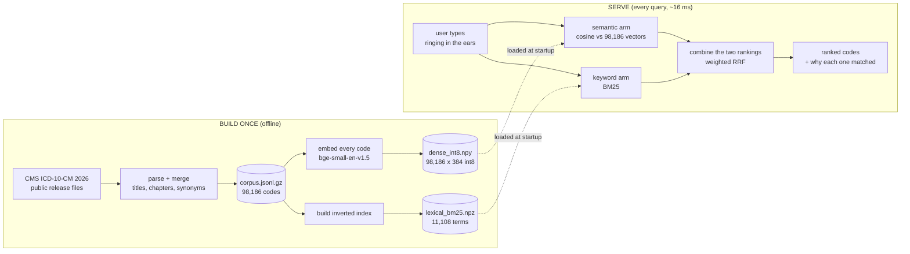
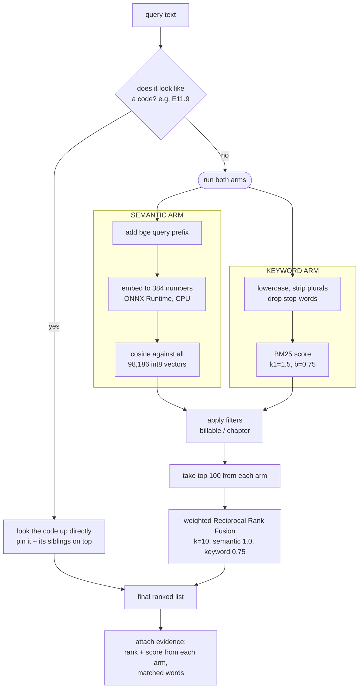

# ICD-10-CM Hybrid Code Finder

**Live demo → <https://icd10-hybrid-search.onrender.com>**

Type what is wrong with a patient in ordinary English. Get the official medical
diagnosis code back.

> Type **"ringing in the ears"** → get **H93.19 Tinnitus**.
> The official title of that code does not contain the words *ringing*, *in*,
> *the* or *ears*. A normal keyword search finds nothing. This one finds it.

[](https://github.com/Sudam23/icd10-hybrid-search/actions/workflows/ci.yml)
[](https://render.com/deploy?repo=https://github.com/Sudam23/icd10-hybrid-search)

> **Demonstration project.** Results are suggestions from public CMS reference
> data. This is not a certified coding tool and not medical advice.

---

## 1. The problem

Every diagnosis recorded in a hospital must be written down as an **ICD-10-CM
code**. There are **98,186** of them. A medical coder reads what the doctor
wrote and finds the matching code.

The hard part is that **codes are written in formal medical language, and
people are not.**

| What a person says | What the official code is called |
|---|---|
| ringing in the ears | Tinnitus |
| nosebleed | Epistaxis |
| high blood pressure | Essential (primary) hypertension |
| loss of smell | Disturbances of smell and taste |

Searching the official list for "nosebleed" by matching words returns nothing
useful, because the word *nosebleed* is not in the title of the code. The coder
has to already know the medical word to find the medical word. That is slow,
and it is the step where mistakes happen.

## 2. What this project solves

It lets you search **98,186 real ICD-10-CM 2026 codes by meaning, not by
spelling** — while still being exact when you need exactness.

It does that by running **two different search engines at the same time** and
combining their answers:

| | What it is good at | What it is bad at |
|---|---|---|
| **Semantic search** (AI embeddings) | Understands that *nosebleed* means *Epistaxis* | Blurs small but critical differences, like *with* vs *without complications* |
| **Keyword search** (BM25) | Exact words, codes, numbers, rare medical terms | Finds nothing if you do not know the medical word |

Neither is good enough alone. **Measured on 1,000 held-out test queries, the
semantic arm alone finds the right code in the top 10 for 69.1% of them, the
keyword arm for 63.7% — and combining them reaches 73.0%.** Of those queries,
118 were found *only* by the semantic arm and 64 *only* by the keyword arm.
That is the whole argument for building it this way, and it is measured rather
than assumed.

---

## 3. How to see it working (2 minutes)

**Open <https://icd10-hybrid-search.onrender.com> and try these in order:**

| # | Type this | What to notice |
|---|---|---|
| 1 | `ringing in the ears` | **H93.19 Tinnitus** comes first. No word of your query is in that title. |
| 2 | Click the **Keyword** button, same query | The right answer **disappears**. This is what a normal search box does. |
| 3 | Click **Semantic**, then **Hybrid** | It comes back. You have just shown why both arms are needed. |
| 4 | `type 2 diabetes with kidney complications` | Precise clinical wording also works — and the `with` / `without` distinction is kept. |
| 5 | `E11.9` | Typing a **code** returns that exact code pinned to the top, plus its sibling codes. |
| 6 | Tick **Billable codes only** | Category codes disappear. Only codes you can actually submit on a claim remain. |
| 7 | Scroll to the bottom | The accuracy tables are **generated from the evaluation run**, not typed by hand. |

Under every result there are small grey tags like
`semantic #1 · cos 0.761` and `keyword #4 · bm25 18.12`. They show **which
engine found that code and at what rank**, so the ranking can be explained
rather than taken on faith.

> The demo runs on a free server that **sleeps after ~15 minutes**. The first
> click after a quiet period waits ~30–60 seconds while it wakes up. Open it
> once before showing it to someone.

---

## 4. Architecture

### 4.1 The big picture



**Left half happens once**, when the index is built (26 minutes on a laptop).
**Right half happens on every query** and takes about 16 milliseconds locally.

### 4.2 What happens to a single query, step by step



Three details in that diagram are deliberate design decisions, not accidents:

**1. Filters are applied *before* the top-100 cut, not after.**
If you filter after cutting, asking for 10 billable codes can return 3, because
7 of the top 10 were categories. Filtering first keeps the page full.

**2. The two arms are combined by rank, not by score.**
A cosine similarity is between -1 and 1. A BM25 score is unbounded — it can be
8 or 40. Adding them together is meaningless. So the position in each list is
used instead: a code ranked 1st by either arm scores `weight / (10 + 1)`. This
is Reciprocal Rank Fusion (Cormack et al., 2009).

**3. A query that looks like a code skips the AI entirely.**
`E11.9` is not English. Embedding it returns nonsense neighbours. So code-shaped
queries are answered by direct lookup, and the code's siblings are shown — the
alternatives a coder is actually choosing between.

### 4.3 How the parts map to the code

| Diagram box | File |
|---|---|
| parse + merge | `src/icd10_search/data/parse.py` |
| embed every code | `src/icd10_search/indexing/embedder.py`, `build.py` |
| int8 compression | `src/icd10_search/indexing/quantize.py` |
| build inverted index | `src/icd10_search/search/lexical.py` |
| semantic arm | `src/icd10_search/search/dense.py` |
| keyword arm | `src/icd10_search/search/lexical.py` |
| weighted RRF | `src/icd10_search/search/fusion.py` |
| the orchestration above | `src/icd10_search/search/service.py` |
| web API + page | `src/icd10_search/api/main.py`, `web/` |
| accuracy measurement | `src/icd10_search/evaluation/` |

Deeper design notes — why there is no FAISS index, why the CMS Alphabetic Index
is deliberately *not* used as a search feature — are in
**[docs/ARCHITECTURE.md](docs/ARCHITECTURE.md)**.

---

## 5. Three engineering decisions worth asking about

**No approximate-nearest-neighbour index (no FAISS, no vector database).**
98,186 vectors × 384 dimensions is about 38 million multiply-adds, which NumPy
does in ~16 ms. An ANN index would add a dependency, a build step and an
accuracy loss to speed up something that is already fast enough. Exact search
means the top 10 is genuinely the top 10.

**The vectors are compressed from 32-bit floats to 8-bit integers.**
That takes the index from 151 MB to 37.7 MB, which is what lets the whole
service fit in a free 512 MB container. The cost was measured, not assumed:
**0.3 percentage points of recall@10** on the test split, and **0.0** on the
lay-language set.

**The official synonyms are indexed, and they are why this works at all.**
CMS publishes "inclusion terms" — 46,144 codes carry them. *"high blood
pressure"* is listed by CMS as a synonym for I10. Finding and parsing those
(they live in two different XML elements, which cost a real bug) raised synonym
coverage from 31,416 codes to 46,144.

---

## 6. Accuracy

Measured on queries the system never saw while being tuned.

<!-- RESULTS:START -->
### CMS Alphabetic Index — held-out test split — 1,000 queries

| Retrieval mode | Recall@1 | Recall@5 | Recall@10 | MRR@10 | Median latency |
|---|---|---|---|---|---|
| Keyword only (BM25) | 38.9% | 56.9% | 63.7% | 0.467 | 0 ms |
| Semantic only | 40.5% | 62.6% | 69.1% | 0.500 | 15 ms |
| **Hybrid (shipped)** | 44.1% | 66.2% | 73.0% | 0.533 | 16 ms |

Why both arms: of these 1,000 queries, **118 were found only by the semantic arm** and **64 only by the keyword arm** (both: 573; neither: 245). Neither arm dominates, which is exactly the case for fusing them.

### Hand-written lay queries — 54 queries

| Retrieval mode | Recall@1 | Recall@5 | Recall@10 | MRR@10 | Median latency |
|---|---|---|---|---|---|
| Keyword only (BM25) | 22.2% | 51.8% | 68.5% | 0.345 | 0 ms |
| Semantic only | 24.1% | 64.8% | 74.1% | 0.412 | 16 ms |
| **Hybrid (shipped)** | 35.2% | 72.2% | 77.8% | 0.493 | 16 ms |

**What int8 quantisation costs:** scoring the same queries against the un-quantised float32 vectors gives recall@10 of 69.4% versus 69.1% for int8 — the 4x smaller index costs 0.30 percentage points.

_Measured on 2026-11-23 with `BAAI/bge-small-en-v1.5`, 98,186 codes indexed. Regenerate with `make eval && python scripts/render_results.py`._
<!-- RESULTS:END -->

**Where the labels come from.** CMS publishes an Alphabetic Index that maps
lay and clinical phrases onto codes. Those pairs are the answer key, so the
grading is done by CMS, not by me. That index is deliberately **not** used as a
search feature — using it on both sides would be marking my own homework.

**How the settings were chosen.** Fusion weights, the RRF constant and the
document text format were picked on a **separate 1,000-query dev split**. The
test numbers above were run once, at the end. Every number in this file is
written by `scripts/render_results.py` from the evaluation output, so none of
them is typed by hand.

Full method, including the queries it still gets wrong:
**[docs/EVALUATION.md](docs/EVALUATION.md)**.

---

## 7. Run it yourself

```bash
git clone https://github.com/Sudam23/icd10-hybrid-search.git
cd icd10-hybrid-search
make venv     # create the environment
make serve    # open http://127.0.0.1:8000
```

The parsed data and both indexes are committed, so this works immediately with
no build step and no downloads.

To rebuild everything from the original CMS files:

```bash
make data     # ~1 min    download and parse the CMS release
make index    # ~26 min   embed all 98,186 descriptions on CPU
make eval     # ~6 min    reproduce every number above
```

The build is deterministic: rebuilding produces an index that is **byte-for-byte
identical** to the committed one (verified by SHA-256), so the shipped artifact
can be checked rather than trusted.

With Docker:

```bash
make docker-build && make docker-run
```

### Checking a deployment

`make test` covers the pieces and the API. `make e2e` checks the thing a user
actually touches: it launches a real Chrome, types with real keystrokes, clicks
the mode toggle, and asserts on what the page renders.

```bash
make e2e                                        # against the live demo
make e2e ARGS="--base-url http://127.0.0.1:8000"  # against a local server
```

It covers 27 checks, including the three that only a browser can see: that
switching to **Keyword** genuinely loses the Tinnitus result, that a shared link
restores its chapter filter, and that the page does not scroll sideways at a
true 390 px phone width. It needs Chrome, so it is a deployment check rather
than part of `make test`.

---

## 8. API

| Endpoint | Purpose |
|---|---|
| `GET /api/search?q=&k=&mode=&billable_only=&chapter=` | Search. `mode` is `hybrid`, `dense` or `lexical`. |
| `GET /api/code/{code}` | Full detail for one code. |
| `GET /api/chapters` | The 22 chapters, for the filter. |
| `GET /api/stats` | Corpus and index facts. |
| `GET /api/evaluation` | The full evaluation report as JSON. |
| `GET /api/health` | Readiness, used by the container health check. |
| `GET /docs` | Interactive API documentation. |

```bash
curl "https://icd10-hybrid-search.onrender.com/api/search?q=nosebleed&k=3"
```

---

## 9. Honest limitations

* **Retrieval, not coding.** It suggests codes. Real coding needs clinical
  context, laterality, encounter type and official guidelines.
* **Accuracy is about 73% in the top 10**, so roughly one query in four is not
  answered within ten results. It narrows a 98,186-item list to ten, which is a
  different job from being right.
* **English only**, and the embedding model is general-purpose rather than
  clinical. A medical model (such as a BioLORD or PubMedBERT variant) is the
  obvious next upgrade.
* **The free demo server is slow.** A query takes about a second there against
  16 ms on a normal machine: the free instance is CPU-throttled and both
  embedding and scoring 98,186 vectors are arithmetic. Keyword-only mode stays
  under a millisecond on the same server, which shows exactly where the time
  goes.
* **No reranker.** A cross-encoder over the top 50 would likely be the single
  biggest accuracy gain, at the cost of latency.

---

## 10. Data and licence

ICD-10-CM is published by CMS/NCHS and is in the **public domain**. The 2026
release files are downloaded directly from cms.gov by `make data`. The code in
this repository is MIT licensed.
